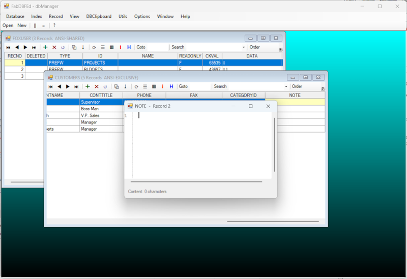

# FabDBFEdEnh

A DBF database manager / editor for Windows, written in [X#](https://www.xsharp.eu/).

Open, browse, edit, filter, index and repair xBase tables (**Visual FoxPro, FoxPro/CDX and Clipper/NTX**),
with a fast live grid, a record form view, an index manager, structure editing that keeps your data,
source code and JSON export of a table, and a JSON export that makes the content of a DBF easy to read for other tools.



## Features

### Opening files
- Drivers **DBFVFP**, **DBFCDX** and **DBFNTX**; memo files (FPT / DBT) and structural indexes (CDX) are opened with the table
- Per file: **shared / exclusive**, **read only**, record number column, deleted column
- Several tables at once (MDI), recent files list, a file can be passed on the command line (double click on a `.dbf`);
  a second start hands the file over to the running instance

### Browsing and editing
- **Live grid** working directly on the work area (virtual mode: only the visible records are read, so large tables stay fast)
- Edit cells in place, **append**, **delete / recall** (single record, all, or **scoped delete** of the current view),
  **undo** of the last change, **commit**
- Record locking in shared mode, optional auto commit
- Typed input for character, numeric, integer, date, DateTime, logical, currency, double and float fields
- **Form view** (one record, all fields) and table view, choose the visible fields
- Go to record number, **seek** in the active index, **filter** expression, **scope** on the active order, show / hide deleted records
- **DBClipboard**: copy or **cut** records (also additive) and paste them over a record or append them

### Memo and binary data
- Memo fields open in a text editor (ICSharpCode.TextEditor), trailing padding is handled for you
- **Binary memo** (`M:B`) and **binary character** (`C:B`) fields open in a **hex viewer**, as does the **hex view of the current record**
- **FPT analysis**: block types, dead space, overlapping or broken memo pointers

### Indexes
- **Index manager**: create, edit and delete orders, take the orders of another DBF, rebuild the whole production CDX
- Open index files, select the active order, **ReIndex**

### Structure
- **Create** a new DBF (field types depend on the driver) and generate an X# record model class for it
- **Modify structure**: add, change, reorder and delete fields. Data is converted, field names can be changed,
  AutoIncrement values and field flags are kept, indexes are listed for recreation, and the original is kept as a dated backup
- Structure info of the open table (header, fields, indexes)

### Utilities
- **DBReplace** (value or expression, optional condition), **Pack**, **Zap**, **ReIndex**, record count
- **Export JSON**: the whole table, or just the current view, as an indented array of objects
  (`Deleted`, `RecNo`, then every field)
- **Generate Create PRG**: source code that recreates the table, in the language of your choice
  - X# with `DbCreate()` and an array (VO / Vulcan dialects), X# with `RddFieldInfo` / `CoreDb.Create` (Core dialect),
    or **Visual FoxPro** (`CREATE TABLE`, `INDEX ON`)
  - optionally with the **index definitions** (key, `FOR` condition, `UNIQUE`)
  - optionally with the **existing records** as `INSERT` / append statements (all records, or only the current view);
    deleted records and binary values are left out, AutoIncrement fields are assigned again by the RDD
- **Generate DBF Desc File**: a plain text description (file facts, fields with offsets and flags, indexes, related files)
- Both generators propose the folder of the DBF in their Save dialog

### Options
- Default driver, locking, default path, date format and century / epoch (the VO date settings), display font
- Settings are stored in `%APPDATA%\FabDBFEdEnh\FabDBFEdEnh.ini`; unhandled errors are logged to `%APPDATA%\FabDBFEdEnh\Error.log`

### Keyboard
| | | | |
|---|---|---|---|
| `Ins` append | `Ctrl+D` delete | `Ctrl+R` recall | `Ctrl+Alt+R` recall all |
| `Ctrl+Home` / `Ctrl+End` top / bottom | `Ctrl+G` go to record | `Ctrl+F` / `Ctrl+S` find / seek | `F2` / `Shift+F2` browse / form |
| `Ctrl+C` copy record | `Ctrl+Alt+C` copy additive | `Ctrl+X` cut record | `Ctrl+Alt+X` cut additive |
| `Ctrl+V` paste | `Ctrl+Alt+A` paste append | `Ctrl+Alt+L` paste append all | `Ctrl+Z` undo |
| `F5` refresh | `F12` commit | `Ctrl+O` open | `Ctrl+N` new |

## Feature status

Everything in the menu, and what is still missing.

| Menu | Feature | Status | Notes |
|---|---|:---:|---|
| **Database** | Open DBF | ✅ | driver, shared / exclusive, read only |
| | New | ✅ | field types depend on the driver |
| | Modify Structure | ✅ | data, AutoIncrement values and flags are kept |
| | Recent files | ✅ | |
| | Favorites | ❌ | menu entry only |
| | Exit | ✅ | optional confirmation |
| **Index** | Open Index File / Close All Index Orders | ✅ | |
| | Index Manager, New Order, Delete Order | ✅ | |
| | Set Active Order | ✅ | |
| | ReIndex | ✅ | needs exclusive access |
| | Seek Index Value | ✅ | soft seek |
| | Recreate all orders for **DBFNTX** | ❌ | works for CDX only |
| **Record** | Append, Delete, Recall, Recall All | ✅ | |
| | Scoped Delete | ✅ | deletes the records of the current view (filter / scope) |
| | Go To Top / Previous / Next / Bottom, Goto RecNo, Find | ✅ | |
| | Refresh, Commit | ✅ | |
| | Undo Changes | ⚠️ | only the last field change |
| | Hex View | ✅ | current record, read from the file |
| **View** | Form / Browse | ✅ | |
| | Set Filter, Set Order Scope | ✅ | needs the X# macro compiler |
| | View Deleted Records Only / All Records | ✅ | |
| | Select Fields | ✅ | |
| **DBClipboard** | Copy, Copy Additive, Cut, Cut Additive | ✅ | |
| | Paste, Paste Append, Paste Append All | ✅ | |
| | View, Clear | ✅ | |
| | Link | ❌ | menu entry only (behaviour undefined) |
| **Utils** | DBReplace | ✅ | value or expression, optional condition |
| | Pack, Zap, Record Count | ✅ | |
| | FPT Analysis | ✅ | |
| | Export JSON | ✅ | whole table or current view |
| | Generate Create PRG | ✅ | X# `DbCreate`, X# `RddFieldInfo`, Visual FoxPro; optional indexes and records |
| | Generate DBF Desc File | ✅ | plain text |
| | DBCalc | ❌ | menu entry only |
| | DBRegEx | ❌ | menu entry only |
| | DBSort | ❌ | menu entry only |
| | DBTotal | ❌ | menu entry only |
| | DBValidation | ❌ | menu entry only |
| | Set Relation, Set Window Relation | ❌ | menu entries only |
| | Associate (`.dbf` file association) | ❌ | menu entry only |
| | Text File Editor | ❌ | menu entry only |
| | Open Database List | ❌ | menu entry only |
| **Options** | Show RecNo, Show Deleted | ✅ | |
| | Auto Commit, Full Path in caption | ✅ | |
| | Display Font, Set Defaults | ✅ | |
| **Window** | Cascade, Tile, Close All | ✅ | |
| **Help** | About | ✅ | |
| **Data** | Binary memo (`M:B`) and binary character (`C:B`) | ✅ | shown in the hex viewer, read only |
| | Binary values in the generated scripts | ❌ | left out on purpose |
| | Unicode / code pages | ⚠️ | the RDD default; not configurable per file |

✅ done  ·  ⚠️ partly  ·  ❌ missing (placeholder menu entries do nothing)

## Requirements
- Windows, **.NET Framework 4.7.2**
- The **X# runtime** (XSharp.Core / Rdd / RT / Data / MacroCompiler). The macro compiler is needed for filters, scopes,
  replace expressions and index creation.

## Building
The repository contains both a Visual Studio and an XIde project:

| IDE | Open | Notes |
|---|---|---|
| Visual Studio (with the X# extension) | `FabDBFEdEnh.sln` | NuGet packages are restored automatically |
| XIde | `FabDBFEdEnh.xiproj` | uses the DLLs in `FabDBFEdEnh\lib` and `FabDBFEdEnh.Tests\lib` |

```
msbuild FabDBFEdEnh.sln -restore
```

The executable is `FabDBFEdEnh\bin\Debug\FabDBFEdEnh.exe` (XIde: `Bin\Debug`).

> A new source file has to be added to **all** project files: `FabDBFEdEnh.xsproj`, and `FabDBFEdEnh.xiapp` + `FabDBFEdEnh.xiproj` for XIde
> (the test project has the same three: `FabDBFEdEnh.Tests.xsproj`, `FabDBFEdEnh.Tests.xiapp`, `FabDBFEdEnh.xiproj`).

## Tests
The `FabDBFEdEnh.Tests` project (xUnit, X# Core dialect) covers the table logic without any window: the operations of `DbfTable`
(open, view, delete / recall, write / undo, append, paste, filter, scope, orders, Zap, raw readers, replace, JSON), the
settings helpers, the structure helpers and the script / description generators. A few smoke tests drive a real `DataWindow`.
Test tables are created in a temporary folder, nothing is stored in the repository.

```
FabDBFEdEnh.Tests\RunTests.ps1                 # PowerShell: finds vstest.console.exe through vswhere
csi.exe FabDBFEdEnh.Tests\RunTests.csx         # the same as a C# script (add "pause" to keep the window open)
```

or use *Test Explorer* in Visual Studio. The tests run one after the other on purpose: the X# RDD layer keeps process-wide state.

## Architecture
- `DbfTable` (`DbfTable.prg`) has no user interface code. It owns the work area, the field metadata and the *view*
  (record list in display order, active order, deleted flag handling, filter and scope), and does every table operation.
  Operations return a `DbfResult` instead of showing dialogs.
- `DataWindow` is the MDI child: grid, form view, toolbar, dialogs and messages. It asks `DbfTable` to do the work.
- `ScriptGenerator` writes the create scripts and the description.

## Repository layout
```
FabDBFEdEnh.sln / FabDBFEdEnh.xiproj      solution (VS) and project (XIde)
FabDBFEdEnh\
    FabDBFEdEnh.xsproj / .xiapp           project (VS) and application (XIde)
    *.prg                                 sources (DbfTable, DataWindow, MainForm, ScriptGenerator ...)
    *.resx                                form resources (Visual Studio designer)
    Resources\                            compiled form resources (XIde)
    lib\                                  ICSharpCode.TextEditorEx, Newtonsoft.Json (XIde; Visual Studio uses NuGet)
FabDBFEdEnh.Tests\
    FabDBFEdEnh.Tests.xsproj / .xiapp     test project (VS) and test library (XIde)
    *.prg                                 tests
    lib\                                  xUnit and its Visual Studio test adapter (XIde; Visual Studio uses NuGet)
    RunTests.ps1 / RunTests.csx           run the tests from a terminal or from an IDE build event
```

## Continuous integration

`.github/workflows/build.yml` builds `FabDBFEdEnh.sln` (Release) on a GitHub hosted Windows runner and uploads the result as an artifact.
The X# compiler is not available on the runner, so the workflow installs it from an installer that you provide: define the repository
variable `XSHARP_INSTALLER_URL` (and optionally `XSHARP_INSTALLER_ARGS`, the silent install switches).
Until it is defined the workflow only prints a warning and skips the build.

## Credits
- Based on [FabDBFEd](https://github.com/FabToys/FabDBFEd) by Fabrice Foray.
- Extended into a dBAdministrator-style editor in a German fork by Horst Korak (thanks to him) , then translated to English, fixed and extended here.

## Third party components
| Component | License |
|---|---|
| [X#](https://www.xsharp.eu/) runtime | Apache License 2.0 |
| [Newtonsoft.Json](https://www.newtonsoft.com/json) | MIT |
| [ICSharpCode.TextEditorEx](https://github.com/StefH/ICSharpCode.TextEditorEx) (SharpDevelop text editor) | LGPL-2.1-or-later |
| [xUnit.net](https://xunit.net/) (tests only) | Apache License 2.0 |

The full notices are in [THIRD-PARTY-NOTICES.md](THIRD-PARTY-NOTICES.md).

## License
[MIT](LICENSE)
